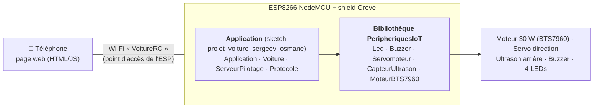

# Architecture du projet

OSMANE Johan, SERGEEV Leonid (3AE FISA)

Voir aussi : [cas d'utilisation](cas_utilisation.md), [classes](diagramme_classes.md), [séquence](diagramme_sequence.md), [câblage](cablage.md), [protocole](protocole.md), [planning](planning.md).

## 1. Vue d'ensemble :

Le téléphone se connecte au Wi-Fi de l'ESP8266, ouvre une page web et pilote la voiture.



Le code est en deux couches :
- **Bibliothèque `PeripheriquesIoT`** (`libraries/`) : capteurs et actionneurs génériques. Elle ne connaît ni la voiture ni `Config.h`, tout passe par les constructeurs. Ses exemples servent de programmes de test.
- **Application** (`projet_voiture_sergeev_osmane/`) : la voiture, le serveur web et la page.

## 2. Traçabilité :

| Critère | Pts | Notre réponse | Séance |
|---|---|---|---|
| Projet qui fonctionne | 4 | Une version qui marche à chaque fin de séance (moteur simulé par 2 LEDs tant que le BTS7960 n'est pas câblé) | 1 à 4 |
| Principes objet | 2 | Encapsulation, classes abstraites, polymorphisme, composition (`Voiture`) | 1 à 3 |
| Plusieurs classes | 1 | ~12 classes dans la bibliothèque, 6 dans l'appli | 1 à 3 |
| Héritage | 1 | `Peripherique` → `Capteur` / `Actionneur` → `Led`, `Buzzer`, `Servomoteur`, `CapteurUltrason`, `MoteurCC` → `MoteurBTS7960` | 1 et 2 |
| Opérateur | 1 | `Serial << moteur` (`operator<<` sur `Print`), `Commande::operator!=` | 1 et 3 |
| STL | 1 | `vector` des périphériques, `map` distance → bip, `array` + `nth_element` (filtre médian), `function` (rappels du serveur) | 1 à 3 |
| Exceptions | 1 | `ErreurBroche` (moteur bloqué), `ErreurMesure` (recul interdit), `ErreurProtocole` (trame ignorée) | 1 à 3 |
| Code propre et commenté | 2 | Doxygen, tout dans `Config.h`, 0 warning, pas de `delay()` | 1 à 4 |
| Qualité et quantité | 2 | Sécurités, filtre médian, mode dégradé, page soignée | 1 à 4 |
| Idée | 2 | Aide au recul comme sur une vraie voiture, sans appli à installer | 3 |
| Rapport | 3 | `docs/rapport.md`, nourri par le journal | 3 et 4 |
| Échéances | −5 | Tag et push à chaque séance | 1 à 4 |

Exigences du cahier des charges :
- Mode AP : `WiFi.softAP()`, page sur `192.168.4.1`.
- Conduite proportionnelle : message `C v d` envoyé 10 fois par seconde.
- Phares et klaxon : `P 0`/`P 1` et `K`.
- Distance en direct : état JSON envoyé 5 fois par seconde.
- Recul : feux auto, bip qui accélère, arrêt sous un seuil réglable (`S n`, de 10 à 100 cm).
- Sécurité : arrêt après 500 ms sans commande, rampe, arrêt de 300 ms avant de changer de sens, direction au neutre au démarrage.
- Non bloquant : tout au `millis()`, ultrason par interruption.
- 3,3 V et broches de boot : voir [cablage.md](cablage.md).
- Exceptions : option à cocher dans l'IDE, et un `#error` si on oublie.
- Une seule bibliothèque externe : WebSockets.

## 3. Les choix à justifier :

**Mode AP.** Les cartes ne sont pas déclarées sur le réseau de l'INSA. L'ESP crée donc son propre réseau, l'adresse est toujours `192.168.4.1` et la démo marche partout. Seul défaut : le téléphone n'a plus Internet pendant qu'on pilote.

**WebSocket.** Une requête HTTP, c'est des centaines d'octets d'en-têtes. Une trame WebSocket, c'est quelques octets. La connexion reste ouverte, donc l'ESP peut envoyer la distance sans qu'on la demande, et on voit tout de suite quand le téléphone décroche (on arrête alors la voiture). En plus, `ESP8266WebServer` traite les requêtes une par une : à 10 par seconde, tout ralentirait.

**Rampe dans la bibliothèque.** Elle protège le moteur et le pont, quelle que soit l'appli. `MoteurCC` calcule la vitesse, `MoteurBTS7960` fait juste le PWM (patron méthode modèle).

**Ultrason par interruption.** `pulseIn()` bloque jusqu'à 30 ms. On mesure l'écho avec une interruption sur les deux fronts. Pas de front montant : le capteur est absent. Écho plus long que la portée : il n'y a pas d'obstacle.

**Sécurité par défaut.** EN du pont est sur GPIO15, à 0 pendant le boot : le moteur ne peut pas partir tout seul. Si le capteur est KO, le recul est interdit. Sous le seuil, on s'arrête sans rampe.

## 4. Arborescence :

`project_name/` est renommé `projet_voiture_sergeev_osmane/` (l'IDE veut que le dossier ait le même nom que le `.ino`). On garde `Application::init()` et `run()` du template.

```
BE_POO_Template/
├── README.md
├── projet_voiture_sergeev_osmane/        APPLICATION
│   ├── projet_voiture_sergeev_osmane.ino
│   ├── Application.h/.cpp     relie la voiture et le serveur
│   ├── Config.h               toutes les constantes
│   ├── Voiture.h/.cpp         conduite, recul, sécurités
│   ├── ServeurPilotage.h/.cpp Wi-Fi, HTTP, WebSocket
│   ├── Protocole.h/.cpp       lecture et écriture des messages
│   └── PageWeb.h              page HTML/JS
├── libraries/PeripheriquesIoT/           BIBLIOTHÈQUE
│   ├── src/                   Peripherique, Capteur, Actionneur, Led, Buzzer,
│   │                          Servomoteur, CapteurUltrason, FiltreMedian,
│   │                          MoteurCC, MoteurBTS7960, Erreurs
│   └── examples/              TestLed, TestBuzzer, TestServo, TestUltrason, TestMoteur
├── docs/                      diagrammes, câblage, protocole, journal, rapport
└── outils/                    compiler.sh, compiler.ps1
```

Pour que l'IDE trouve la bibliothèque, on fait un lien :
- Windows : `mklink /J "%USERPROFILE%\Documents\Arduino\libraries\PeripheriquesIoT" "<dépôt>\libraries\PeripheriquesIoT"`
- Linux : `ln -s "<dépôt>/libraries/PeripheriquesIoT" ~/Arduino/libraries/`

Archive des sources : `git archive --format=zip --prefix=projet_voiture_sergeev_osmane/ -o projet_voiture_sergeev_osmane_sources.zip HEAD`

## 5. Outils :

- Core esp8266 3.1.2.
- WebSockets (Markus Sattler), version notée en séance 2.
- arduino-cli (celui de l'IDE Arduino 2), FQBN `esp8266:esp8266:nodemcuv2:exception=enabled`.
