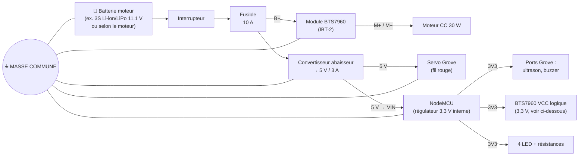

# Brochage, câblage et alimentation

## 1. Contraintes de la carte NodeMCU 1.0 (ESP-12E)

| Broche | GPIO | Contrainte | Usage possible |
|---|---|---|---|
| D0 | 16 | **Pas de PWM, pas d'interruption**, niveau haut au boot. Pas de port Grove. | à éviter ici |
| D1 | 5 | aucune (I2C SCL par défaut) | ✅ PWM |
| D2 | 4 | aucune (I2C SDA par défaut) | ✅ PWM |
| D3 | 0 | **Boot** : doit être HAUT au démarrage, sinon passage en mode flash. Rappel interne vers le haut. | sortie qui ne tire jamais la broche vers le bas au repos |
| D4 | 2 | **Boot** : doit être HAUT. LED bleue du module (active à l'état bas). Pas de port Grove. | LED d'état interne |
| D5 | 14 | aucune | ✅ |
| D6 | 12 | aucune | ✅ |
| D7 | 13 | aucune | ✅ |
| D8 | 15 | **Boot** : doit être BAS au démarrage (rappel de 10 kΩ vers la masse sur la carte) | sortie qui doit être basse au boot |
| RX | 3 | haut au boot, réception série | utilisable en sortie si on renonce à la réception série |
| TX | 1 | haut au boot, émission série | réservé aux traces de débogage |
| A0 | ADC | entrée analogique 0–3,3 V (pont diviseur sur la NodeMCU) | non utilisé (perspective : courant moteur via `R_IS`) |
| — | 6–11 | flash SPI interne | **interdites** (`ErreurBroche`) |

## 2. Ports du shield Grove pour NodeMCU

Selon le wiki Seeed, le shield a 5 ports numériques (D3, D5, D6, D7, D8), 1 port analogique (A0), 2 ports I2C (D1/D2) et 1 port UART (RX/TX). **Il n'y a pas de port D4.**
Seul le **fil jaune** (signal principal) de chaque port est utilisé.
La tension VCC des ports Grove n'est pas indiquée dans la documentation. Elle vient a priori du 3,3 V de la NodeMCU et sera **mesurée en séance 1** (voir le §6).

## 3. Table d'affectation

| Fonction | Broche | GPIO | Connexion | Justification |
|---|---|---|---|---|
| BTS7960 **RPWM** (marche avant) | D1 | 5 | port I2C, fil jaune → Dupont | PWM nécessaire. Aucune contrainte de boot, donc pas de glitch moteur au démarrage. |
| BTS7960 **LPWM** (marche arrière) | D2 | 4 | même port I2C, fil blanc → Dupont | idem |
| BTS7960 **R_EN + L_EN** (reliées) | D8 | 15 | port D8 → Dupont | GPIO15 est **forcée à 0 au boot** : le pont reste désactivé pendant tout le démarrage, quels que soient les états transitoires des autres broches. L'entrée du module ne la remonte pas (à vérifier, voir le §6). |
| Servo de direction (signal) | D5 | 14 | port D5 | sortie servo sans contrainte. Le servo est alimenté en 5 V à part (voir le §4). |
| Capteur ultrason (SIG) | D6 | 12 | port D6 | broche bidirectionnelle avec **interruption** (impossible sur GPIO16) |
| Buzzer | D7 | 13 | port D7 | **surtout pas sur D3** : le transistor d'entrée du module Grove tirerait GPIO0 vers la masse, et la carte démarrerait en mode flash |
| Phares (2 LED) | D3 | 0 | port D3 → breadboard | câblage **actif à l'état bas** : 3V3 → R → LED → D3. Au boot, D3 est haute donc les LED sont éteintes, et rien ne tire GPIO0 vers le bas. Le démarrage est préservé. |
| Feux de recul (2 LED rouges) | RX | 3 | port UART, fil RX → breadboard | actif à l'état bas, même montage. Le port série est ouvert en **émission seule** (`Serial.begin(115200, SERIAL_8N1, SERIAL_TX_ONLY)`), ce qui conserve les traces de débogage. Pendant un téléversement, les feux clignotent, sans conséquence. |
| LED d'état | D4 | 2 | LED bleue interne | aucun câblage : objet `Led(2, actifBas=true)` |
| Traces série | TX | 1 | USB | débogage, inventaire `operator<<` |

Bilan : 9 sorties pour 9 broches exploitables. D0 n'est pas utilisée : elle n'a ni PWM ni interruption et n'est pas accessible par un port Grove.

**Repli si les feux sur RX posent problème** : relier `R_EN` et `L_EN` en permanence au 3V3, mettre une résistance de 10 kΩ vers la masse sur RPWM et sur LPWM (le pont reste immobile pendant le boot), et brancher les feux de recul sur D8, en actif à l'état haut (LED vers la masse, ce qui est compatible avec le niveau bas exigé au boot). Il suffit alors de modifier `Config.h`.

## 4. Alimentation et masse commune

- **Batterie séparée pour le moteur.** Un moteur de 30 W consomme environ 2,5 A sous 12 V, et bien plus au démarrage. Il ne doit jamais passer par l'USB ni par le régulateur de la NodeMCU. Le BTS7960 accepte de 5,5 à 27 V et jusqu'à 43 A.
- **Servo en 5 V stable.** Le servo appelle des pics de courant qui feraient redémarrer l'ESP (brown-out) s'il était sur le 3,3 V. On l'alimente par le convertisseur 5 V. On coupe le fil rouge du câble Grove, ou on utilise un câble Grove vers Dupont : SIG sur D5, GND commun, VCC sur le 5 V. Un condensateur de 470 µF près du servo absorbe les pics.
- **Masse commune obligatoire** : batterie, BTS7960, convertisseur, servo et NodeMCU. Sans elle, les signaux PWM n'ont pas de référence.
- **Logique du BTS7960 en 3,3 V.** Le module IBT-2 passe ses entrées par un 74HC244 alimenté par sa broche VCC. S'il est alimenté en 5 V, le seuil d'entrée au niveau haut (environ 3,5 V) est **au-dessus** des 3,3 V de l'ESP, ce qui donne un fonctionnement aléatoire. En alimentant VCC du module par le 3V3 de la NodeMCU, les niveaux sont compatibles.
- **Pendant les séances 1 et 2, sur table** : alimentation par l'USB seulement, servo sur VIN/VU (5 V de l'USB) à vide, moteur **remplacé par 2 LED** sur RPWM et LPWM. On voit ainsi la rampe, le sens et la pause d'inversion sans le BTS7960.

## 5. Compatibilité 3,3 V de chaque module

| Module | Alimentation | Niveau du signal vers l'ESP | Verdict |
|---|---|---|---|
| Grove Ultrasonic Ranger v2.0 | 3,2–5,2 V (fiche Seeed), « compatible 3,3 V » depuis la v2.0 | l'écho sort au niveau de son VCC | ✅ **à condition qu'il soit alimenté en 3,3 V**. En 5 V, l'écho à 5 V sur SIG imposerait un pont diviseur (l'ESP8266 n'est pas officiellement tolérant au 5 V). |
| Grove Buzzer | 3,3–5 V | entrée seulement | ✅ |
| Servo Grove | 4,8–6 V | entrée seulement (consigne à 3,3 V acceptée par les servos courants) | ✅ avec un 5 V séparé |
| BTS7960 (IBT-2) | logique 3,3 V (voir le §4), puissance sur batterie | entrées seulement, `R_IS`/`L_IS` non câblées | ✅ avec VCC logique à 3,3 V |
| LED | 3,3 V par les GPIO | — | ✅ courant d'environ 4 mA par LED, sous la limite d'un GPIO |

**LED et résistances.** Pour une LED rouge (Vf ≈ 2,0 V), R = (3,3 − 2,0) / 4 mA ≈ 330 Ω.
Une LED blanche (Vf ≈ 3,0 V) éclaire faiblement sous 3,3 V. Pour les phares, on prendra donc des LED jaunes (330 Ω) ou des LED blanches avec 68 Ω (≈ 4 mA). Chaque broche commande 2 LED, soit environ 8 mA au total, sous la limite d'environ 12 mA d'un GPIO.
Si l'éclairage reste trop faible, on ajoute un MOSFET à commande logique (AO3400 ou IRLZ44N) côté masse, avec les LED en 5 V. Sa grille ne consomme pas de courant et ne perturbe donc pas GPIO0.

## 6. Vérifications à faire au multimètre (séance 1, avant de brancher le moteur)

1. Tension **VCC d'un port Grove** du shield, carte alimentée par l'USB : on attend **3,3 V**. Si on mesure 5 V : pont diviseur 10 kΩ / 20 kΩ sur SIG de l'ultrason, ou alimentation de l'ultrason par un 3,3 V à part.
2. **Continuité** port → broche NodeMCU pour chaque port utilisé (D3, D5, D6, D7, D8, I2C jaune/blanc, UART RX). On note dans le journal quel fil du port UART correspond à RX.
3. **BTS7960** : résistance entre `R_EN` et VCC, pour vérifier qu'aucun rappel vers le haut n'empêcherait GPIO15 d'être basse au boot.
4. Au démarrage, oscilloscope ou LED témoin sur D1, D2 et D8 : aucune impulsion pendant le boot.
