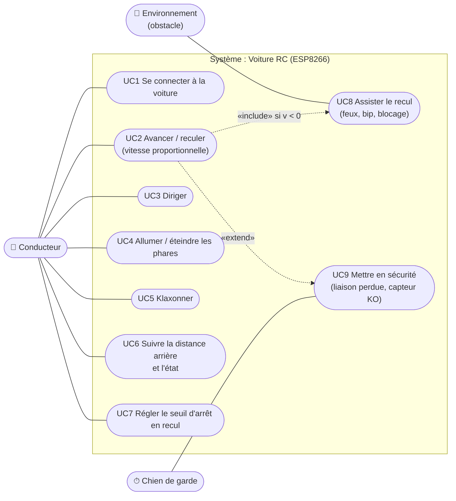

# Cas d'utilisation et scénarios

## Acteurs
- **Conducteur** : la personne qui pilote depuis le navigateur de son téléphone. C'est l'acteur principal.
- **Environnement** : les obstacles derrière la voiture. Acteur secondaire, perçu par le capteur ultrason.
- **Horloge et chien de garde** : déclenche les comportements automatiques de sécurité. Acteur interne, représenté pour la lisibilité.

## Diagramme

## Fiches courtes

| UC | Déclencheur | Résultat attendu | Règles |
|---|---|---|---|
| UC1 Se connecter | Le conducteur rejoint le Wi-Fi `VoitureRC` et ouvre `192.168.4.1` | La page s'affiche et l'indicateur « connecté » passe au vert | Un seul conducteur à la fois |
| UC2 Avancer / reculer | Le conducteur fait glisser la pédale verticale avec le pouce | La vitesse suit la position (−100 à +100 %) avec une rampe | Passage par l'arrêt avant chaque inversion, pause de 300 ms |
| UC3 Diriger | Le conducteur fait glisser le volant horizontal avec l'autre pouce | Les roues suivent (−100 à +100 % de l'amplitude) | Retour au neutre quand le pouce est relâché |
| UC4 Phares | Bouton « Phares » | Les 2 LED avant s'allument ou s'éteignent | État renvoyé dans la page |
| UC5 Klaxon | Bouton « Klaxon » | Son de 400 ms | Prioritaire sur le bip de recul |
| UC6 Suivre l'état | Automatique, 5 fois par seconde | Distance (cm), vitesse, mode (ARRÊT, AVANT, ARRIÈRE, BLOQUÉ, SÉCURITÉ), état du capteur | — |
| UC7 Régler le seuil | Curseur « Seuil » dans la page | Nouveau seuil appliqué immédiatement (10 à 100 cm) | Défaut : 20 cm |
| UC8 Assister le recul | La vitesse ou la consigne devient négative | Feux de recul allumés, bip dont la période diminue avec la distance, arrêt immédiat sous le seuil | Hystérésis de 5 cm ; la marche avant reste permise |
| UC9 Mettre en sécurité | Aucune commande pendant 500 ms, déconnexion, ou capteur en défaut | Moteur à l'arrêt, son coupé, mode SÉCURITÉ affiché. Si le capteur est KO, le recul est interdit. | Reprise automatique à la commande suivante |

## Scénarios

### S1 — Démarrage et connexion
1. On met la voiture sous tension. Le pont en H est désactivé (GPIO15 au niveau bas au boot), la direction est au neutre et la LED d'état clignote lentement : pas de conducteur.
2. Sur le port série, l'inventaire des périphériques s'affiche grâce à `operator<<`. On y voit par exemple `[MoteurBTS7960 RPWM=5 LPWM=4 EN=15] [Servomoteur D5 neutre=90°]…`
3. Le conducteur rejoint le réseau `VoitureRC` (mot de passe dans le README) puis ouvre `http://192.168.4.1`.
4. La page ouvre le WebSocket `ws://192.168.4.1:81/`. La LED d'état passe au fixe et l'indicateur de la page au vert.
5. La page envoie `C 0 0` toutes les 100 ms (heartbeat) et l'ESP diffuse l'état toutes les 200 ms.
6. *Variante, broche invalide dans `Config.h`* : une `ErreurBroche` est levée à l'initialisation. Le moteur reste désactivé, le message d'erreur apparaît sur le port série et la LED d'état clignote en SOS.

### S2 — Conduite avec phares
1. Le conducteur appuie sur « Phares ». La page envoie `P 1`, les LED avant s'allument et l'état renvoie `"ph":1`.
2. Il pousse la pédale à 70 %. La page envoie `C 70 0` à 10 Hz et la vitesse monte en rampe (environ 0,35 s pour atteindre 70 %).
3. Il tourne à gauche : `C 70 -50`, le servo se place à neutre − 50 % de l'amplitude.
4. Il appuie sur « Klaxon » : `K`, le buzzer sonne 400 ms.
5. Il relâche les pouces : `C 0 0`, la vitesse redescend en rampe et les roues reviennent au neutre.
6. *Variante, téléphone verrouillé* : plus aucune trame n'arrive. Au bout de 500 ms, l'ESP passe en mode SÉCURITÉ et la consigne tombe à 0. Au déverrouillage, la page se reconnecte et la conduite reprend.

### S3 — Marche arrière avec obstacle
1. Voiture à l'arrêt, obstacle à 1,20 m derrière. Le conducteur tire la pédale à −50 % (`C -50 0`).
2. `MoteurCC` part de 0 et applique la rampe vers −50 %. `Voiture` allume les feux de recul.
3. À 80 cm, le bip a une période de 500 ms. À 50 cm, 250 ms. À 30 cm, 120 ms. Les périodes sont lues dans une `std::map` avec `lower_bound`.
4. Sous 60 cm, la vitesse de recul est plafonnée à 30 % pour pouvoir s'arrêter à temps.
5. À 20 cm, soit le seuil : arrêt **immédiat**, bip continu, mode BLOQUÉ affiché en rouge sur la page. Les commandes `C -x …` sont ignorées.
6. Le conducteur pousse la pédale en avant (`C 40 0`). Le moteur respecte la pause d'inversion puis avance. Au-delà de 25 cm (seuil + hystérésis), le blocage est levé. Dès que la vitesse redevient positive, les feux de recul s'éteignent et le bip s'arrête.
7. *Variante, capteur débranché* : il n'y a plus de front d'écho et `distanceCm()` lève une `ErreurMesure`. `Voiture` l'attrape, interdit le recul et la page affiche « capteur KO ». La marche avant reste possible.

Le diagramme de séquence de S3 est dans [diagramme_sequence.md](diagramme_sequence.md).
