# Diagramme de classes

Le diagramme est écrit en Mermaid, que GitHub affiche directement. Il distingue deux espaces :
- `Bibliotheque_PeripheriquesIoT` : `libraries/PeripheriquesIoT`, générique et réutilisable ;
- `Application_projet_voiture_sergeev_osmane` : `projet_voiture_sergeev_osmane/`, propre à la voiture.

Les exceptions dérivent toutes de `std::runtime_error`.

```mermaid
classDiagram
    direction TB

    namespace Bibliotheque_PeripheriquesIoT {
        class Peripherique {
            <<abstract>>
            #const char* nom_
            #uint8_t broche_
            #bool pret_
            +Peripherique(nom, broche)
            +~Peripherique()
            +begin() void
            +update(maintenantMs) void
            +decrire(Print& sortie) void
            +type()* const char*
            +nom() const char*
            +broche() uint8_t
            +estPret() bool
            +estBrocheValide(broche)$ bool
            +estBrochePwm(broche)$ bool
            #verifierConfiguration() void
            #initialiser()* void
            #decrireDetails(Print& sortie) void
            #exigerBrocheValide(broche) void
            #exigerPwm(broche) void
        }
        class Capteur {
            <<abstract>>
            -uint32_t periodeMs_
            -uint32_t derniereAcquisitionMs_
            +update(maintenantMs) void
            +periodeMs() uint32_t
            #acquerir(maintenantMs)* void
        }
        class Actionneur {
            <<abstract>>
            +arreter()* void
        }
        class Led {
            -bool actifBas_
            -bool allumee_
            -uint32_t periodeClignotementMs_
            +allumer() void
            +eteindre() void
            +commuter(bool allumee) void
            +basculer() void
            +clignoter(periodeMs) void
            +estAllumee() bool
            +arreter() void
            +update(maintenantMs) void
        }
        class Buzzer {
            -uint16_t frequenceHz_
            -Fond fond_
            -uint16_t periodeMs_
            -bool bipPonctuel_
            +bip(dureeMs, frequenceHz) void
            +bipPeriodique(periodeMs) void
            +continu() void
            +silence() void
            +arreter() void
            +update(maintenantMs) void
        }
        class Servomoteur {
            -Servo servo_
            -uint8_t angleNeutre_
            -uint8_t amplitude_
            -int8_t orientation_
            +orienter(int pourcent) void
            +orientation() int8_t
            +angle() uint8_t
            +arreter() void
        }
        class CapteurUltrason {
            -FiltreMedian~uint16_t~ filtre_
            -volatile uint32_t debutEchoUs_
            -volatile uint32_t finEchoUs_
            -uint8_t echecs_
            +distanceCm() uint16_t
            +estFiable() bool
            +echecsConsecutifs() uint8_t
            #acquerir(maintenantMs) void
            -declencher() void
            -exploiterEcho() void
            -isrEcho(void* arg)$ void
        }
        class FiltreMedian~T~ {
            -std::array~T,N~ valeurs_
            -size_t nb_
            +ajouter(T valeur) void
            +mediane() T
            +vider() void
            +estVide() bool
        }
        class MoteurCC {
            <<abstract>>
            -int8_t consigne_
            -float vitesse_
            -float penteParS_
            -uint16_t pauseInversionMs_
            +setConsigne(int8_t pourcent) void
            +consigne() int8_t
            +vitesse() int8_t
            +arreter() void
            +arretImmediat() void
            +update(maintenantMs) void
            #appliquer(int8_t vitesse)* void
        }
        class MoteurBTS7960 {
            -uint8_t brocheLpwm_
            -uint8_t brocheEnable_
            -uint16_t pwmMax_
            +begin() void
            #appliquer(int8_t vitesse) void
        }
        class ErreurPeripherique {
            +ErreurPeripherique(message)
        }
        class ErreurBroche
        class ErreurMesure
    }

    namespace Application_projet_voiture_sergeev_osmane {
        class Application {
            -Voiture voiture_
            -ServeurPilotage serveur_
            -Led ledEtat_
            +init() void
            +run() void
        }
        class Voiture {
            -MoteurBTS7960 moteur_
            -Servomoteur direction_
            -CapteurUltrason radarArriere_
            -Buzzer buzzer_
            -Led phares_
            -Led feuxRecul_
            -std::vector~Peripherique*~ peripheriques_
            -std::map~uint16_t,uint16_t~ tableBip_
            -uint16_t seuilArretCm_
            -uint32_t derniereCommandeMs_
            -ModeConduite mode_
            +begin() void
            +appliquer(const Commande& c) void
            +update(maintenantMs) void
            +miseEnSecurite() void
            +etat() EtatVoiture
            +afficherInventaire(Print& sortie) void
            -gererRecul(maintenantMs) void
        }
        class ServeurPilotage {
            -ESP8266WebServer http_
            -WebSocketsServer ws_
            -std::function~void(const Commande&)~ surCommande_
            -std::function~void()~ surDeconnexion_
            +begin() void
            +update() void
            +diffuser(const EtatVoiture& e) void
            +clientConnecte() bool
        }
        class Protocole {
            <<utility>>
            +decoder(const char* texte)$ Commande
            +encoder(const EtatVoiture& e, char* tampon, size_t taille)$ size_t
        }
        class Commande {
            <<struct>>
            +TypeCommande type
            +int8_t vitesse
            +int8_t direction
            +uint16_t valeur
            +operator==(const Commande&) bool
            +operator!=(const Commande&) bool
        }
        class EtatVoiture {
            <<struct>>
            +int8_t vitesse
            +int8_t consigne
            +int8_t direction
            +int16_t distanceCm
            +uint16_t seuilCm
            +bool phares
            +bool feuxRecul
            +bool capteurOk
            +ModeConduite mode
        }
        class ModeConduite {
            <<enumeration>>
            ARRET
            AVANT
            ARRIERE
            BLOQUE
            SECURITE
        }
        class ErreurProtocole
    }

    class runtime_error["std::runtime_error"]

    %% Héritage des périphériques
    Peripherique <|-- Capteur
    Peripherique <|-- Actionneur
    Capteur <|-- CapteurUltrason
    Actionneur <|-- Led
    Actionneur <|-- Buzzer
    Actionneur <|-- Servomoteur
    Actionneur <|-- MoteurCC
    MoteurCC <|-- MoteurBTS7960
    CapteurUltrason *-- FiltreMedian

    %% Exceptions
    runtime_error <|-- ErreurPeripherique
    ErreurPeripherique <|-- ErreurBroche
    ErreurPeripherique <|-- ErreurMesure
    runtime_error <|-- ErreurProtocole
    CapteurUltrason ..> ErreurMesure : lève
    Peripherique ..> ErreurBroche : lève
    Protocole ..> ErreurProtocole : lève

    %% Application
    Application *-- Voiture
    Application *-- ServeurPilotage
    Application *-- "1" Led : ledEtat_
    Voiture *-- MoteurBTS7960
    Voiture *-- Servomoteur
    Voiture *-- CapteurUltrason
    Voiture *-- Buzzer
    Voiture *-- "2" Led : phares, feux de recul
    Voiture ..> Commande
    Voiture ..> EtatVoiture
    Voiture --> ModeConduite
    ServeurPilotage ..> Protocole
    Protocole ..> Commande
    Protocole ..> EtatVoiture
```

## Lecture du diagramme

- **`Peripherique`** regroupe ce qui est commun à tout composant : un nom, une broche, un état « prêt », le cycle de vie `begin()` puis `update()`, et la description `decrire()`.
  - `begin()` et `decrire()` suivent le patron *interface non virtuelle* : le déroulement est fixé dans la classe de base (vérifier la configuration, puis initialiser le matériel, puis marquer prêt), et les classes filles ne fournissent que les étapes virtuelles `verifierConfiguration()`, `initialiser()`, `type()` et `decrireDetails()`.
  - Le constructeur ne touche pas au matériel et ne lève jamais d'exception : les objets peuvent être globaux, alors qu'une exception levée avant `setup()` ne pourrait pas être attrapée. Toute vérification a lieu dans `begin()`.
  - La vérification des broches (`exigerBrocheValide()`, `exigerPwm()`) est faite une fois pour toutes ici. Elle lève une `ErreurBroche` pour GPIO6–11 (flash interne) ou si on demande du PWM sur GPIO16.
  - `operator<<(Print&, const Peripherique&)` est une fonction libre qui appelle `decrire()`, une méthode virtuelle. On peut donc écrire `Serial << moteur` quelle que soit la classe réelle de l'objet.
- **`Capteur`** factorise le cadencement : `update()` appelle `acquerir()` toutes les `periodeMs_`.
- **`Actionneur`** impose `arreter()`, la mise en sécurité propre à chaque actionneur. La LED s'éteint, le buzzer se tait, le servo revient au neutre et le moteur passe à une consigne nulle. `Voiture::miseEnSecurite()` parcourt simplement ses actionneurs.
- **`MoteurCC`** contient toute la logique indépendante du pont en H : rampe, pause d'inversion, arrêt immédiat. **`MoteurBTS7960`** ne fait que traduire une vitesse signée en PWM sur RPWM et LPWM, et gérer EN. Un autre pont (L298N, DRV8871) ne demanderait qu'une nouvelle classe fille.
- **`Voiture`** est une **composition** : elle possède ses périphériques et la durée de vie est commune. `peripheriques_` (`std::vector<Peripherique*>`) pointe vers ces membres pour les traiter de façon polymorphe. Les pointeurs ne sont pas propriétaires, donc il n'y a pas d'allocation dynamique.
- **`ServeurPilotage`** ne connaît pas `Voiture`. Il signale les commandes reçues par des `std::function` branchées dans `Application::init()`. Le serveur peut ainsi être testé seul et la voiture peut être pilotée par une autre source, par exemple le port série.
